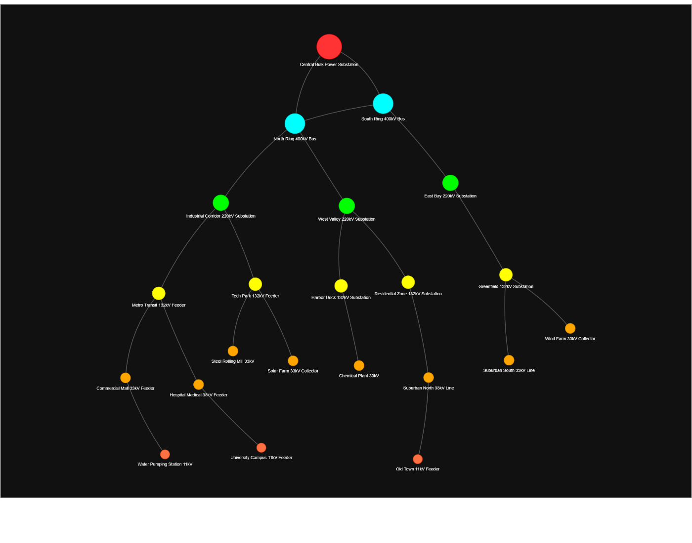
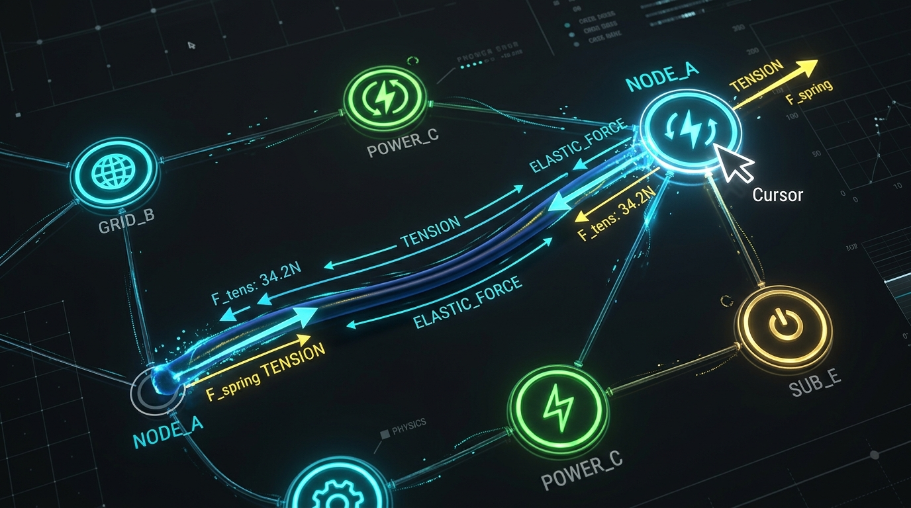

# ⚡ Network Feeder Design (Rubber Tree Feeder Viewer)

An interactive, physics-driven electrical power grid distribution feeder network visualizer built with **Python**, **NetworkX**, **Pandas**, and **PyVis (Vis.js)**.



> **💡 The Origin of Dangle:**  
> The elastic **Barnes-Hut spring physics** and dynamic rubbery curved wire simulation in this project directly inspired the mechanics and gameplay of the minimalist network puzzle game **[Dangle](https://github.com/DevEN-PS/Dangle)**!

---

## 🌟 Key Features

* **⚡ Auto-Generated Sample Power Grid**: Runs out-of-the-box! If `nodes.csv` or `branches.csv` are missing, the script automatically generates a realistic 22-bus multi-tier distribution grid.
* **🌳 BFS Hierarchical Tree Layout**: Performs Breadth-First Search (BFS) starting from the primary Bulk Power Substation (`SS`), arranging the feeder tiers downward symmetrically.
* **🎨 Voltage-Based Styling**: Node diameters and neon colors dynamically reflect operational voltage levels (400 kV, 220 kV, 132 kV, 33 kV, 11 kV).
* **🧲 Elastic Rubber Physics**: Powered by the **Barnes-Hut** gravity and spring algorithm with dynamic Bezier curved wires that flex, stretch, and bounce when dragged.
* **🏝️ Microgrid & Island Handling**: Automatically identifies disconnected electrical islands and renders them systematically without breaking tree traversal.
* **🌐 Self-Contained Web Output**: Exports directly to a standalone, zero-dependency `network.html` featuring interactive pan, zoom, hover tooltips, and node dragging.

---

## 🔬 Physics & Mechanics



The visualizer simulates power lines as elastic springs and buses as repulsive charged particles:
* **`springLength (140)`**: Natural relaxed span between electrical buses.
* **`springConstant (0.01)`**: The elasticity coefficient that gives power lines their signature rubber-band recoil.
* **`gravitationalConstant (-2500)`**: Inter-node electrostatic repulsion preventing feeder congestion.
* **`damping (0.45)`**: Kinetic energy dissipation for smooth settling.
* **`smooth: { type: "dynamic" }`**: Fluid spline recalculation on every physics tick.

---

## 📊 Voltage Classification & Color Legend

| Voltage Rating | Color | Hex Code | Node Size | Electrical Network Role |
| :--- | :---: | :---: | :---: | :--- |
| **Root Substation** | 🔴 Red | `#FF3333` | `35` | Primary Bulk Power Injection Point (auto-detected via `"SS"`) |
| **$\ge$ 400 kV** | 🔵 Cyan | `#00FFFF` | `28` | Extra High Voltage (EHV) Transmission Ring |
| **$\ge$ 220 kV** | 🟢 Emerald | `#00FF00` | `22` | High Voltage (HV) Regional Grid Substations |
| **$\ge$ 132 kV** | 🟡 Yellow | `#FFFF00` | `18` | Sub-Transmission Primary Feeders |
| **$\ge$ 33 kV** | 🟠 Orange | `#FFA500` | `14` | Industrial & Commercial Distribution Feeders |
| **$\ge$ 11 kV** | 🪸 Coral | `#FF7043` | `13` | Municipal & Local Town Distribution Lines |
| **Default / Other** | ⚪ Slate | `#AAAAAA` | `12` | Unspecified Auxiliary Nodes |

---

## 🚀 Quick Start

### 1. Clone the Repository
```bash
git clone https://github.com/DevEN-PS/network-feeder-design.git
cd network-feeder-design
```

### 2. Install Requirements
```bash
pip install -r requirements.txt
```

### 3. Run the Visualizer
```bash
python network_feeder_viewer.py
```

### 4. Explore the Grid
Open the generated **`network.html`** in any modern web browser:
* **Left-click + Drag**: Grab any bus to test rubber wire tension.
* **Scroll Wheel**: Zoom in/out smoothly.
* **Hover**: View rich HTML tooltips with Bus ID, Substation Name, and Voltage level.

---

## 📁 Custom Datasets Format

You can visualize any custom electrical grid by editing or replacing `nodes.csv` and `branches.csv`:

### `nodes.csv`
```csv
bus_id,label,kv
SS_CENTRAL_400,Central Bulk Power Substation,400
BUS_400_NORTH,North Ring 400kV Bus,400
SS_220_IND,Industrial Corridor 220kV Substation,220
BUS_132_METRO,Metro Transit 132kV Feeder,132
FEEDER_33_A1,Commercial Mall 33kV Feeder,33
DIST_11_TOWN,Old Town 11kV Feeder,11
```

### `branches.csv`
```csv
from,to
SS_CENTRAL_400,BUS_400_NORTH
BUS_400_NORTH,SS_220_IND
SS_220_IND,BUS_132_METRO
BUS_132_METRO,FEEDER_33_A1
FEEDER_33_A1,DIST_11_TOWN
```

---

## 🛠️ Project Structure

```
network-feeder-design/
├── assets/
│   ├── feeder_network_preview.png  # High-res canvas screenshot
│   └── rubber_spring_physics.jpg   # Physics vector schematic
├── network_feeder_viewer.py        # Core graph processor & PyVis builder
├── nodes.csv                       # Auto-generated sample buses dataset
├── branches.csv                    # Auto-generated sample branches dataset
├── network.html                    # Interactive self-contained web visualizer
├── requirements.txt                # Python dependencies (pandas, networkx, pyvis)
└── README.md                       # Documentation & architecture guide
```

---

## 📜 License
This project is open-source and available under the **MIT License**.
